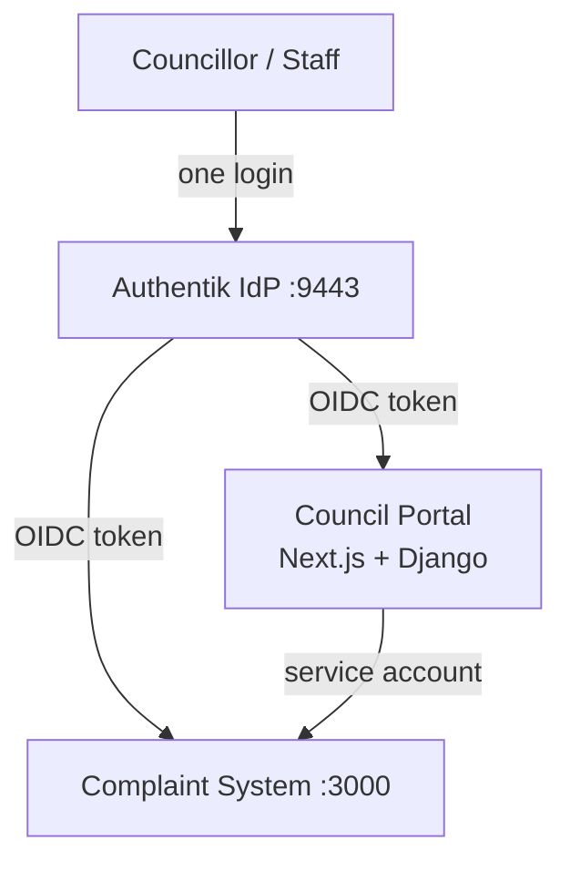

# NextGen DAM — SaaS Digital Asset Management Platform

A cloud-native Digital Asset Management solution: **Create once, reimagine everywhere.**

**Stack**: React Next.js (Server Actions + Turbopack) · Django REST Framework (JWT) · PostgreSQL · Shadcn UI · Tailwind CSS · Docker

**Last updated:** 1 November 2026

---

## Architecture

```
┌──────────────┐        ┌────────────────────┐        ┌──────────────┐
│  Next.js 16  │  HTTP  │  Django 6 + DRF    │  SQL   │  PostgreSQL  │
│  (App Router │        │  (JWT Auth + API)  │        │  (Docker)    │
│   + Actions) │        │                    │        │              │
│ localhost:300│◀──────▶│  localhost:8000    │◀──────▶│  (db + pgAdmin)│
└──────────────┘   JWT  └────────────────────┘        └──────────────┘
       │                        │
       │                        └─ media volume (uploads persist)
       │
       └─ S3-ready storage backend (swap local → S3)
```

## Core Features

| Category | Features |
|---|---|
| **Asset Management** | Upload, organize into collections, preview (PDF/img/audio/video), download tracking |
| **Multi-tenancy** | Teams/workspaces with isolated asset storage |
| **Client Sharing** | Time-limited, password-protected share links |
| **Social** | Comments, ratings (1–5 stars), activity feeds |
| **Profiles** | Self-service username, email, SA cell number, avatar, bio, password change |
| **Calendar** | Meetings month view, My/All filter, day drill-down, links to collections/documents |
| **Access control** | Superadmin-granted capabilities, employee numbers, forced first-login password change |
| **Data Protection** | RBAC, audit logs, file encryption at rest (planned) |
| **Admin Panel** | Statistics dashboard, user/team management, audit trail |

---

## Access Model — Accounts, Authentication & Authorization

Three separate questions, three separate layers. Keep them separate or the system becomes confusing:

- **Authentication** = *who you are* (login, JWT tokens).
- **Accounts / tenancy** = *where you belong* (teams, membership, active workspace).
- **Authorization** = *what you may do* (capabilities, folder ACLs, team roles).

```
Login (AuthN) → Identity (User)
                    │
        ┌───────────┴────────────┐
        │                        │
  Accounts/tenancy         Authorization
  (where you work)         (what you can do)
  Team + Membership        ├─ Capabilities (feature switches)
  UserProfile.active_team  ├─ Team membership (data partition)
                           ├─ Category ACL (folder access)
                           └─ Team role (team admin only)
```

### The four authorization layers

| Concept | Question it answers | Implemented by | Configured in |
|---|---|---|---|
| **Authentication** | "Who is this request?" | SimpleJWT + session auth, `IsAuthenticated` | `/login`, `frontend/lib/api.ts` |
| **Accounts / tenancy** | "Which workspace do I belong to?" | `Team`, `Membership`, `UserProfile` | `/dashboard/team`, `python/accounts/models.py` |
| **Capabilities** | "Which *features* may I use?" | Django permissions `accounts.view_teams`, `documents.share_files`, `accounts.edit_employee_numbers`; `manage_access` = superuser | `/dashboard/access`, Django admin |
| **Content ACL** | "Which *folders/assets* may I see?" | `Category.access_groups/access_users`, per-file equivalents, `Category.is_shareable` | Django admin → Categories/Files |
| **Team role** | "May I administer this team?" | `Membership.role` = owner / admin / member | `/dashboard/team` |
| **Platform admin** | "May I do anything?" | `is_superuser` (bypass), `is_staff` (stats) | Django admin |

**Key separation:** Django **Groups** ("Councillors", "TopManagement") are *content roles* used only by the Category ACL. **Teams** are *data partitions*. A group never grants team access, and a team role never grants extra folder access.

### Decision order (single source of truth)

Every category/file read in `python/documents/models.py` runs:

```
1. superuser?                  → allow
2. is_published?               → else deny
3. object.team is set?         → user must be a member of that team
4. user whitelisted on object? → allow
5. object has access_groups?   → user must be in ≥1 of them
6. otherwise                   → allow (all members of the team)
```

Then:

| Action | Extra rule |
|---|---|
| **View/download file** | file ACL **and** its category ACL must both pass (cascade) |
| **Create share link** | `share_files` capability **and** `category.is_shareable=True` **and** view access |
| **Public share link** | token + optional password — intentionally bypasses login/ACL, so the gates above matter |
| **View Teams** | `view_teams` capability |
| **Manage team members** | superuser, or `owner`/`admin` membership |
| **Manage capabilities** | superuser only |

Effective rules:

```
can_view  = superuser OR (published AND in_team AND folder_acl AND file_acl)
can_share = (superuser OR share_files) AND category.is_shareable AND can_view
can_admin = superuser OR membership.role ∈ {owner, admin}
```

### Worked example

Setup: Team **Emalahleni Council**; groups `Councillors`, `Councillors-Finance`; folder
`Council Meetings/Annexures` limited to `Councillors-Finance` with `is_shareable=False`.

| Step | alice (Finance group) | bob (Councillors) | carol (other team) |
|---|---|---|---|
| Authenticated | ✅ | ✅ | ✅ |
| Published | ✅ | ✅ | ✅ |
| Team member | ✅ | ✅ | ❌ → **404** |
| Category ACL | ✅ | ❌ → **404** | — |
| Result | **sees it** | **404** | **404** |

alice's attempt to create a share link → **403**, even with `share_files`, because the category is not shareable.

### Modelling subgroups

Django groups are **flat** — there is no native nesting. Use:

- **Folder hierarchy** → the Category tree (`Council Meetings > Annexures > 2026 Budget`).
- **Role hierarchy** → separate flat groups (`Councillors`, `Councillors-Finance`, `Councillors-Finance-Budget`).
- **Access inheritance** → grant groups on the highest folder possible; the cascade reaches files. Add users to every group whose access they need.
- A true nested-group model would require a new `GroupHierarchy` model — only if committees outgrow flat groups.

Rule of thumb: **hierarchy lives in the folder tree, not in the group tree.**

### Who configures what

| Task | Who | Where |
|---|---|---|
| Create users (with employee number + default password) | Superadmin | `/dashboard/access` |
| Edit employee numbers | Superadmin or users granted `edit_employee_numbers` | `/dashboard/access` |
| Create users/groups, assign users to groups | Superadmin | Django admin |
| Grant `view_teams` / `share_files` | Superadmin | `/dashboard/access` |
| Create teams, add/remove members, switch workspace | Superadmin, team owner/admin | `/dashboard/team` |
| Set folder visibility, mark confidential (`is_shareable`) | Superadmin | Django admin → Categories |
| Create share links for non-confidential assets | Anyone with `share_files` | Asset detail page |

### Caveats

1. **`active_team` is a default, not a restriction.** Reads use the union of a user's team memberships; uploads use the active team. To enforce "one workspace at a time", compare against `get_active_team(user)` in `_can_view`.
2. **Legacy `team = NULL` content is visible to every authenticated user** — assign existing content to a team for full isolation.
3. **No ACL on a category = visible to all members of that team.**
4. **Individual whitelist (`access_users`) beats group restriction.**
5. **Share links are bearer tokens** — revoke them from `/dashboard/shared`; disabling `is_shareable` kills existing links immediately.
6. **`is_staff` sees global statistics; `is_superuser` bypasses ACL and manages access** — keep the two distinct.

### Rules that keep it coherent

1. **Teams partition data** — never use a team to express a role.
2. **Groups express content roles** — never use a group to grant features.
3. **Capabilities express features** — never encode them in team roles or folder ACLs.
4. **Folder ACL expresses sensitivity** — grant at the highest folder, mark confidential folders non-shareable.

---

## Current Status: MVP Core Complete

### ✅ Phase 1-8 (Emalahleni Council Portal → DAM Foundation)
All 8 phases complete. The existing `documents` app (Category, StoredFile, Comment, Rating, DownloadLog, UploadLog) is the perfect foundation for DAM assets.

---

## Current Status: MVP Complete ✅

All 8 phases + dashboard UI complete. Full stack running and verified.

### Completed Deliverables

| Phase | Scope | Status |
|---|---|---|
| 1-8 (Backend) | Django app, models, API, JWT auth, ACL, seeding | ✅ Complete |
| 5 (Frontend Shell) | Pages, components, auth, preview | ✅ Complete |
| 6 (Preview Polish) | Content-type resolution, comments fetch | ✅ Complete |
| 7 (Admin Stats) | Stats endpoints + dashboard home | ✅ Complete |
| 8 (Hardening) | JWT auth, seed_portal command, Docker media | ✅ Complete |
| Client sharing | `SharedLink` (expiry + password), public share page, `/dashboard/shared` | ✅ Complete |
| Multi-tenancy | `accounts` app: Team/Membership/UserProfile, team-scoped assets, `/dashboard/team` | ✅ Complete |
| Capabilities | Superadmin grants `view_teams` / `share_files`; per-category sharing policy (`is_shareable`) blocks confidential folders | ✅ Complete |
| User profiles | Self-service username, email, SA cell number, bio, avatar upload, password change | ✅ Complete |
| Employee numbers | Unique `S`-prefixed (7 chars), editable only by superadmin/assigned editors; new users get default password + forced first-login change | ✅ Complete |
| Calendar | Meetings month view + sticky upcoming sidebar; `/dashboard/calendar` and standalone `/calendar`; My/All filter; clickable dates → day view; meeting times link to related collection/document/meeting; staff CRUD | ✅ Complete |
| Tests | 87 backend tests (ACL, uploads, sharing, teams, capabilities, profiles, calendar) | ✅ Complete |
| Dashboard UI | Sidebar, header, asset/collection pages | ✅ Complete |

### Running Services

| Service | URL |
|---|---|
| Frontend (Next.js 16) | http://localhost:3000 |
| Standalone Calendar | http://localhost:3000/calendar |
| Backend (Django 6 + DRF) | http://127.0.0.1:8000 |
| Admin | http://127.0.0.1:8000/admin/ (admin/admin123) |
| JWT Login | POST http://127.0.0.1:8000/api/auth/token/ |

### Next Steps (when resuming)

1. **Production Docker** — fix frontend image build (`pnpm` build-script approval)
2. **S3 storage** — `django-storages` + `boto3`
3. **CI/CD** — GitHub Actions running `python manage.py test` + `next build`

---

## 2. Backend — `documents` app

### 2.1 Models

```python
class Category(models.Model):
    parent = models.ForeignKey('self', null=True, blank=True,
                               on_delete=models.CASCADE, related_name='children')
    title = models.CharField(max_length=255)
    slug = models.SlugField(unique=True)          # Phoca "alias"
    description = models.TextField(blank=True)
    image = models.ImageField(upload_to='categories/', blank=True)
    # ACL
    access_groups = models.ManyToManyField(Group, blank=True,
                                           related_name='category_access')
    access_users = models.ManyToManyField(User, blank=True,
                                          related_name='category_access')
    # Ownership
    owner = models.ForeignKey(User, null=True, on_delete=models.SET_NULL,
                              related_name='owned_categories')
    is_published = models.BooleanField(default=True)
    ordering = models.PositiveIntegerField(default=0)

class StoredFile(models.Model):
    class StorageKind(models.TextChoices):
        LOCAL = 'local'
        EXTERNAL = 'external'

    category = models.ForeignKey(Category, on_delete=models.CASCADE,
                                 related_name='files')
    title = models.CharField(max_length=255)
    slug = models.SlugField()
    description = models.TextField(blank=True)
    storage = models.CharField(choices=StorageKind.choices, default=StorageKind.LOCAL)
    local_file = models.FileField(upload_to='files/%Y/%m/', blank=True)
    external_url = models.URLField(blank=True)     # file on external server
    filesize = models.BigIntegerField(default=0)
    mime_type = models.CharField(max_length=100, blank=True)
    # ACL (same pattern as Category)
    access_groups = models.ManyToManyField(Group, blank=True)
    access_users = models.ManyToManyField(User, blank=True)
    owner = models.ForeignKey(User, null=True, on_delete=models.SET_NULL)
    is_published = models.BooleanField(default=True)
    download_count = models.PositiveIntegerField(default=0)
    created / modified timestamps

class Comment(models.Model):
    content_type = FK to ContentType        # polymorphic: file OR category
    object_id = PositiveIntegerField()
    content_object = GenericForeignKey()
    user = FK(User)
    text = TextField()
    is_approved = BooleanField(default=True)
    created = DateTimeField(auto_now_add=True)

class Rating(models.Model):                  # 1–5 stars, one per user per object
    content_type / object_id / content_object   (generic)
    user = FK(User)
    value = PositiveSmallIntegerField(validators=[MinValueValidator(1),
                                                  MaxValueValidator(5)])
    unique_together: (content_type, object_id, user)

class DownloadLog(models.Model):             # statistics view
    file = FK(StoredFile, related_name='download_logs')
    user = FK(User, null=True)
    downloaded_at = DateTimeField(auto_now_add=True)
    ip_address = GenericIPAddressField(null=True)

class UploadLog(models.Model):
    file = FK(StoredFile, related_name='upload_logs')
    user = FK(User)
    uploaded_at = DateTimeField(auto_now_add=True)
    action = choices: created / replaced
```

### 2.2 ACL rules (Phoca-style)

Enforced in a single helper used by every endpoint:

```python
def can_access(obj, user) -> bool:
    if user.is_superuser: return True
    if not obj.is_published: return False
    if obj.access_users.filter(pk=user.pk).exists(): return True
    if obj.access_groups.exists() and not obj.access_groups
            .filter(pk__in=user.groups.all()).exists(): return False
    return True
```

- No ACL set → public (to authenticated portal users).
- Groups/users set → whitelist only.
- Category ACL **cascades**: a file is visible only if the user can access the
  category **and** the file.
- Team isolation: objects with a `team` are visible only to that team's members;
  blank team means shared with every authenticated user.
- Share links require the `documents.share_files` capability, **and** the file's
  category must have `is_shareable=True`. Confidential folders such as
  "Annexures" should be marked non-shareable; existing links die immediately.
- Capabilities (`accounts.view_teams`, `documents.share_files`) are granted only
  by the superadmin via `/dashboard/access` or Django admin.
- Django groups double as council roles: `Councillors`, `TopManagement`,
  `Admin`. No `Public` group — authenticated users without explicit ACL restrictions are treated as public to published content.

### 2.3 File type handling (preview / play / download)

Determined from `mime_type` / extension:

| Type | Extension | Behaviour |
|---|---|---|
| PDF | `.pdf` | inline preview (browser PDF viewer) |
| Image | `.png .jpg .jpeg .gif .webp` | `` preview |
| Audio | `.mp3 .wav .ogg` | HTML5 `<audio>` player |
| Video | `.mp4 .webm` (`flv` → convert to mp4) | HTML5 `<video>` player |
| Other | everything else | download only |

API endpoint `GET /api/files/<id>/download/`:
1. ACL check → 403 if denied.
2. Increment `download_count`, write `DownloadLog`.
3. `local` → serve with `FileResponse` (X-Accel-Redirect friendly).
4. `external` → 302 redirect to `external_url`.

Upload endpoint accepts multipart POST, validates extension/size, computes
`filesize` + `mime_type`, writes `UploadLog`.

### 2.4 REST API (DRF)

```
/api/auth/login/            POST   session login (csrf)
/api/auth/me/               GET    current user + groups

/api/categories/            GET    visible tree/list (filtered by ACL)
/api/categories/<slug>/     GET    detail + children + files
POST/PUT/DELETE                    admin only

/api/files/?category=<slug> GET    list visible files in category
/api/files/<id>/            GET    metadata + preview type + rating summary
/api/files/<id>/download/   GET    ACL + counter + serve/redirect
/api/files/<id>/upload-replace/ POST admin/owner

/api/objects/<ct>/<id>/comments/  GET/POST
/api/objects/<ct>/<id>/ratings/   GET summary, POST (upsert own rating)

/api/admin/stats/downloads/ GET    paginated DownloadLog (admin)
/api/admin/stats/uploads/   GET    paginated UploadLog (admin)
/api/admin/stats/summary/   GET    totals per file/category/user
```

Serializers expose computed fields: `preview_kind`, `can_download`,
`rating_avg`, `rating_count`, `comment_count`.

### 2.5 Django admin

Register all models with `raw_id_fields` for ACL M2Ms; statistics via
`DownloadLog`/`UploadLog` list views with date filters and CSV export action.

---

## 3. Frontend — Next.js

```
app/
  (portal)/
    page.tsx                     # root category tree
    categories/[slug]/page.tsx   # subcategories + file grid/table
    files/[id]/page.tsx          # detail: preview, comments, ratings
    login/page.tsx
  admin/
    statistics/page.tsx          # downloads/uploads tables + filters
components/
  CategoryTree, FileCard, FileTable, Preview (pdf/img/audio/video switch),
  CommentList, CommentForm, StarRating, AclNotice
lib/
  api.ts                         # fetch wrapper (credentials: 'include')
  file-types.ts                  # preview kind mapping
```

Key behaviours:
- Session-cookie auth against Django (`CSRF` token handling in `api.ts`).
- `Preview` component switches on `preview_kind` from API.
- Admin statistics page guarded client-side by role + server-side by API ACL.
- Tailwind styling; loading skeletons; 403 page variant for ACL denials.

---

## 4. Phased Delivery

| Phase | Scope | Done when |
|---|---|---|
| **1. Scaffold** | `documents` app, models, migrations, admin registration, DRF installed | `makemigrations`/`migrate` pass, admin browsable |
| **2. Core API** | Categories + files CRUD ACL-filtered, auth endpoints | Authenticated user sees only permitted tree |
| **3. Files I/O** | Upload/download endpoints, logs, external URL support | Download increments stats; external 302 works |
| **4. Social** | Comments + ratings endpoints | Users can comment/rate files & categories |
| **5. Frontend shell** | Layout, login, category tree, file list | Portal navigable at :3000 |
| **6. Preview** | Preview component (pdf/img/audio/video) | PDFs preview inline, mp3 plays |
| **7. Admin stats** | Statistics pages + Django admin reports | Upload/download logs visible with filters |
| **8. Hardening** | Permissions polish, seed data, Docker media volume, docs | Full flow works in Docker |

---

## 5. Docker / Ops Notes

- Add `media/` named volume to `web` service: `- media:/app/media` (uploads
  persist across rebuilds).
- For truly external storage later: swap in `django-storages` (S3) or keep the
  `external_url` field and host files on a separate nginx box — the model
  already supports both.
- `DEBUG=0` in production; serve media via nginx (`X-Accel-Redirect`) rather
  than Django.
- Seed: management command `seed_portal` creating groups (Councillors,
  TopManagement, Admin), sample categories/files, and a superuser.

### Git repositories & branches

The project uses **two repositories**:

| Repository | Contents | Branches |
|---|---|---|
| [councilportalv2](https://github.com/Msaination/councilportalv2) | Django backend (`python/`), docs, and the frontend submodule pointer | `main`, `staging` |
| [councilportalv2-frontend](https://github.com/Msaination/councilportalv2-frontend) | Next.js UI (`frontend/`) | `main`, `staging` |

- `main` = production-ready; `staging` = pre-production integration.
- The parent repo pins an **exact frontend commit** through the submodule, so
  each parent branch defines its precise backend + UI deployment.
- Current state: both parent branches pin frontend `50703f6`; the frontend
  `main` and `staging` branches are also at `50703f6`.
- Deploy staging:
  `git clone --recurse-submodules -b staging https://github.com/Msaination/councilportalv2.git`
- Frontend change flow: commit/push on frontend `staging`, then `git add frontend`
  in the parent `staging` branch and commit the bumped pointer. Promote the same
  way into `main`.

---

## 6. External Integration — Municipality Complaint Management System

**Requirement (from project owner):** ward councillors log into the Council
Portal and see the complaints/statuses that belong to them, pulled from the
municipality's existing Complaint Management System (CMS).

- CMS location: `http://172.20.17.16:3000/dashboard` (LAN only)
- Verified: the CMS is a **Next.js** app (Turbopack build) — same family as
  the portal frontend, reachable server-to-server on the municipal LAN.
- Councillors currently have **separate logins** for each system today.

### 6.1 Integration options

| Option | How it works | When to use |
|---|---|---|
| **A. Server-to-server gateway (recommended)** | Portal user logs in once (portal JWT). Django calls the CMS API/database with a **service account**, filters by the councillor's identity, returns data to the portal. | Fastest path; CMS login untouched; all authorization decided in our trusted backend. |
| **B. True SSO (OIDC/OAuth)** — **DECIDED** | Shared IdP — **Authentik** (see §6.6). Both apps accept one credential issued by Authentik. | Chosen by the project owner for Phase 3. Still requires CMS to support OIDC login — see the §6.3 discovery gate. |
| **C. Shared user table / direct DB read** | Django reads the CMS database directly (ideally a read-only view). | Stopgap only — couples the systems at schema level; CMS updates can break us silently. |

**Avoid:** browser-side calls from the portal frontend straight to the CMS API
(needs CORS, duplicate token handling, and client-trustable filtering =
insecure).

### 6.2 Authentication workflow (Option A)

```
Councillor ──logs in once──▶ Portal (Next.js) ──JWT──▶ Django
                                                          │
                                        maps employee no. ─┤
                                        → CMS identity    │
                                                          ▼
                                              CMS API / DB (service
                                              account, LAN, server-to-server)
```

- Councillors keep **one credential** — the portal login. They never see CMS
  credentials; the browser never touches the CMS.
- Django ↔ CMS trust is a **service account / internal API key**, not user
  credentials.
- Identity mapping: portal **employee numbers** (unique `S`-prefixed, already
  in `UserProfile`) ↔ CMS user ID — a small mapping table in our Postgres.

### 6.3 Phased workflow

1. **Discovery (no code)**
   - Does the CMS expose a REST/GraphQL API, or only a UI? (Probe `/api/*`.)
   - **SSO gate (hard requirement):** does the CMS support OIDC login? If
     not, SSO becomes a feature request to the CMS developers and Phase 2
     (service-account gateway) remains the only path for Phase 3's goal.
   - How does it authenticate (own login, JWT, session cookie)?
   - How are complaints keyed to a councillor — ward number, user ID, name?
   - Data needed: list, status, dates, ward. **Read-only first** — no write-back.
2. **Phase 2 — read-only dashboard (quick win)**
   - Mirror/cache table in our Postgres (or live fetch, depending on volume).
   - Django endpoint `GET /api/complaints/` — resolves logged-in councillor →
     CMS identity → returns their complaints.
   - Portal page "My Complaints" (status badges: open / in progress /
     resolved) + dashboard widgets ("open complaints", "resolved this month").
3. **Phase 3 — SSO with Authentik** (decided, see §6.6): deploy Authentik as
   the shared IdP on the municipal LAN; both the portal and the CMS
   authenticate against it. The §6.2 gateway is retained for complaint data.
4. **Phase 4 — write-back** (e.g. "escalate" from the portal): only after
   Phase 2 is stable. Start read-only; it halves the risk.

### 6.4 Caveats

- If the CMS has **no API**, fall back to (in order of preference): a small
  API added to the CMS → a read-only DB view → a scheduled sync (e.g. every
  15 min). A scheduled sync is usually the pragmatic middle ground.
- Both systems are on the `172.20.x.x` LAN — server-to-server calls are
  trivial and already isolated from the internet.
- Decide **freshness**: real-time vs. cached (15 min). For council dashboards
  caching is almost always fine and kinder to the CMS.
- Filtering by councillor must happen **server-side** (our backend), never in
  the browser.

### 6.5 Identity decision record (auth, user creation, data flow)

**Decision: the Council Portal is the system of record for councillor
identities. The CMS is a downstream consumer.**

| Question | Decision |
|---|---|
| Self-registration for councillors? | **No.** Admin creates the account (keeps employee numbers verified, no unknown accounts in a system holding council documents). Open registration would need an approval queue anyway = admin creation with extra steps. |
| Default access level | Existing model: authenticated access gated by capabilities/ACLs — viewing "my complaints" is ordinary member access, no special capability needed. |
| First-login password change | **Keep the current portal flow**: admin creates → forced password change on first login → councillor active. |
| Which system registers first? | **Council Portal.** It already owns the profile model (employee number, cell, email, avatar) and the creation workflow. The CMS is a point solution; point solutions don't own org-wide identities. |
| How does the CMS get councillor data (name, email, cell, employee no.)? | Provisioned **from** the portal — never manually re-entered in the CMS. Mechanism, per CMS capability: **(1)** push provisioning (Django → CMS API via service account), **(2)** pull sync (CMS/scheduled job fetches the roster from a portal admin endpoint), or **(3)** SSO claims from a shared IdP (Phase 3). |
| Who owns profile edits? | **Portal only.** CMS mirrors; changes propagate portal → CMS, never the reverse. |
| Passwords | The portal password never flows to the CMS. Under Option A the CMS account exists only so complaint records have an owner (councillors may never log in there directly); under SSO the CMS has no password of its own. |

**Rule of thumb:** register and edit in the Council Portal; every other
system subscribes.

### 6.6 SSO decision — Authentik as the Identity Provider

**Decision (2026-11-10): the project will use Authentik as the dedicated IdP
for Phase 3 SSO.**



- **Flow:** portal (or CMS) redirects to Authentik → user logs in once →
  Authentik issues an OIDC token with claims (name, email, employee number,
  roles) → each app validates the token server-side. No password ever
  reaches the applications; the browser only ferries redirects.
- **Profile data** arrives in the token claims at each login — no identity
  sync jobs needed; profile edits in the portal are reflected on next login.
- **Why Authentik:** Docker-native (fits the existing compose stack), user
  federation back to Django (portal stays the creation point per §6.5), MFA /
  password policy / lockout in one place, fully self-hosted on the municipal
  LAN (no data leaves the network).
- **Roles are unchanged:** Authentik is the *login broker*, not the source of
  truth. Accounts are still created in the Council Portal (§6.5) and
  federated to Authentik; the §6.1 Option A gateway still carries complaint
  *data* — SSO answers "who is this?", the gateway answers "which data may
  they see?".
- **Sequencing:** portal integration with Authentik first; CMS integration
  only after the §6.3 discovery gate confirms the CMS supports OIDC.
- **Phase 2 is still required** regardless — the gateway is needed for
  complaint data either way.

---

## 7. Immediate Next Steps

1. **Production Docker** — fix the frontend image build (pnpm build-script approval) and run `docker compose up -d --build`.
2. **CI/CD** — GitHub Actions running `python manage.py test` and the Next.js build.
3. **S3 storage** — swap local media for `django-storages` + `boto3` when needed.
